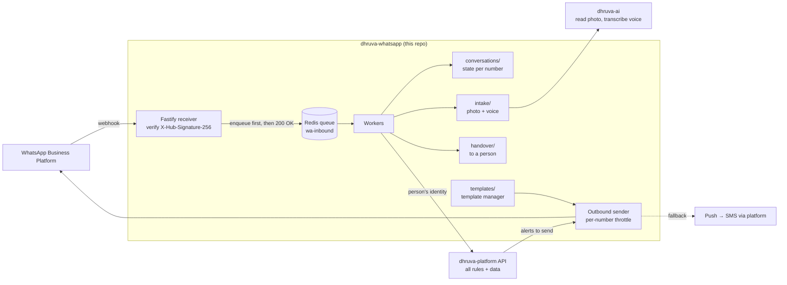

# dhruva-whatsapp

The DhruvaOne **WhatsApp gateway**. It receives WhatsApp Business Platform webhooks, puts every inbound message on a queue **before** processing it, keeps conversation state, manages message templates, takes in photos and voice notes, and hands conversations over to a person. **It holds no business rules.**

| | |
|---|---|
| Stack | TypeScript, Fastify 5, BullMQ on Redis (queue first) |
| Needed from | Phase 1 (Apr–Sep 2027). In the MVP, WhatsApp alerts and delivery reports run inside `dhruva-platform` behind an adapter; this gateway runs as its own service from Phase B. Move it earlier if the Dhruva bot is confirmed for the first release. |
| Targets | Webhook 99.9% monthly with **no lost inbound messages**, including during deploys (WAB 8.7). Attendance alert on WhatsApp within 60 s; bus alert within 30 s. |
| Design docs | [Repositories and Technology Stack](https://github.com/Dhruva-One/dhruva-docs/blob/main/Technology/DhruvaOne%20Repositories%20and%20Technology%20Stack.md) · [Technical Architecture](https://github.com/Dhruva-One/dhruva-docs/blob/main/Technology/DhruvaOne-Technical-Architecture.md) |

## Purpose

- Let parents, teachers and staff use DhruvaOne from WhatsApp in English and Hindi. For example: apply for leave by voice note, send a photo of an attendance register or mark sheet, check a payslip behind a PIN, or ask Dhruva a question.
- Send template messages (alerts, reminders) with a throttle per WhatsApp number, falling back to push and then SMS through the platform.
- Kept separate because its availability target is stricter than the rest of the system and it needs per-tenant rate isolation.

## High-level architecture



### Principles

- **Queue first.** The receiver only verifies the signature, writes the message to the queue and acknowledges it. Nothing slow happens on the webhook path, so Meta never times out and a crash or deploy loses nothing.
- **No business rules.** Who the sender is, which school they belong to and what they are allowed to do are all decided by `dhruva-platform`. AI work goes through `dhruva-ai`.
- **Per-tenant isolation.** Rate limits per tenant and a throttle per WhatsApp number, so one school cannot use up a number's limits.
- **Own data.** Conversation state lives in the gateway's own tables (its own schema and database role), never in the platform's tables. The current in-memory store is a placeholder.
- **Privacy in logs.** Phone numbers are masked; message content, OTPs and PINs are never logged.

## Repository layout

| Path | Purpose |
|---|---|
| `src/server.ts` | Fastify app: `/health`, `GET /wa/webhook/{account_id}` (verification), `POST /wa/webhook/{account_id}` (queue first) |
| `spec/endpoints.json`, `src/spec/stubs.ts` | The 28 gateway APIs from spec section 8; the webhook is built, the other 26 answer 501 until built |
| `src/worker.ts` | Queue worker that processes inbound messages |
| `src/webhook/` | Signature verification and payload parsing (with tests) |
| `src/queue/` | Queue definitions |
| `src/conversations/` | Conversation state |
| `src/platform/` | Platform API client (to be generated from the platform's OpenAPI contract) |
| `src/templates/`, `src/intake/`, `src/handover/` | Template manager, photo and voice intake, handover to a person (to build) |
| `scripts/simulate-inbound.ts` | Sends a signed test message to the local gateway |

## Run it locally

**Prerequisites:** Node.js 20 or later (`.nvmrc`), Docker (for Redis). No Meta account is needed for local work.

```bash
docker compose up -d          # Redis
cp .env.example .env
npm install

npm run dev                   # terminal 1: gateway on http://localhost:3100
npm run worker                # terminal 2: queue worker
npm run simulate              # terminal 3: send a signed test message
```

The simulator should print `gateway responded 200`, and the worker should log `[inbound] text from 9198****** ...`.

Other checks:

```bash
curl localhost:3100/health
curl "localhost:3100/wa/webhook/local-account?hub.mode=subscribe&hub.verify_token=local-verify-token&hub.challenge=123"   # echoes 123
curl localhost:3100/internal/spec/coverage   # built vs stubbed spec APIs
npm test                      # signature, parsing and spec-coverage tests
npm run typecheck
npm run build && npm start    # compiled server (npm run start:worker for the worker)
```

To receive real webhooks from Meta during development, expose port 3100 with a tunnel and set the callback URL and `WHATSAPP_VERIFY_TOKEN` in the Meta app. Use a test number, never a school's production number.

## Open decisions

- Whether the Dhruva bot belongs in the first release (WhatsApp open question 1); this decides when the gateway goes live.
- Regional languages beyond English and Hindi (Phase 1).

## Related repositories

`dhruva-platform` · `dhruva-ai` · `dhruva-apps` · `dhruva-site` · `dhruva-infra` · `dhruva-connectors`, all in the [Dhruva-One](https://github.com/Dhruva-One) organisation.
